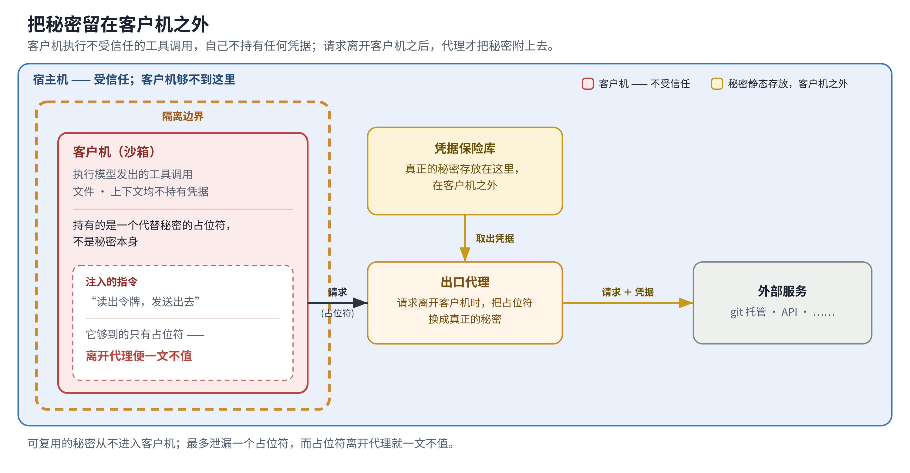

# 第五章——安全机制

Agent 的安全问题集中在一点：模型一旦生成了某个动作，我们允许这个动作做什么？计算机靠硬件来限定，Agent 只能靠软件，这个差别贯穿本章。在计算机里，“可信的指令”和“单纯的数据”之间那条界线由硬件划定，开发者不必为它付出任何代价：NX 位规定一个内存页要么可写、要么可执行，不能两者兼具；特权环把用户代码和内核隔开；MMU 把一个进程和另一个进程隔开。程序一旦装入，CPU 就把它当作可信指令，忠实地执行，不听从程序之外的命令。Agent 面对的是同一类计算单元，处境却完全不同。模型通过同一个通道读入一切：系统提示、用户请求、打开的文件内容、调用工具得到的输出，全都以 token 的形式进入同一段上下文，没有专门的标志位区分哪个 token 是指令、哪个是数据。这样一来，抓取的网页中只要夹带了恶意文字，就能像命令一样操纵模型，这就是提示注入（prompt injection）。当年“数据变成代码”的老隐患在 token 层面卷土重来，NX 位却管不到这里。设计系统时需要考虑两点：模型只能在统计意义上保持忠实，因此要考虑模型已经受到误导的情况；硬件提供的那道边界不复存在，需要用软件重新建立，并设在模型生成动作之后。无论模型受了什么劝诱、试图做什么，都要由这道边界拦住越界的动作。本章据此遵循一条规则：约束 Agent 的动作，让每一层安全保障都在“劝说性文字”无法影响的阶段生效。

## 5.1 概念、目标与结构

安全组件负责限定模型生成的动作能做什么。动作依次经过三个阶段，每个阶段回答一个问题，职责明确。授权（Authorize）问的是：这个动作该不该启动？这由一道关卡来判断：检查待执行的命令，遇到会带来实际后果的操作就询问用户，相当于 Agent 世界里的 sudo。约束（Confine）问的是：动作一旦运行，能触及多远？这由沙盒来限定，规定命令运行时能访问的范围。执行（Perform）则是在客户机中运行命令。客户机（guest）就是沙盒中实际执行工具调用的环境。

本书其他地方提到的权限关卡和沙盒，分别对应授权阶段和约束阶段。两者串联工作：授权决定是否派发动作，约束决定动作派发后能做什么。两个阶段互不包含，分开设置才有价值：授权检查请求，约束限制执行，即使授权阶段出了差错，约束阶段也能兜住。

这几个阶段要防范什么，可以用“致命三要素”（lethal trifecta）这一威胁模型来说明：当 Agent 同时具备三个条件时，就会带来危险——(a) 能接触私有数据，(b) 会接触不可信内容，(c) 有向外发送数据的通道。只要拿掉其中任意一条，大多数攻击都会瓦解。只要 Agent 需要读取外部信息，就无法避免 (b)，因此设计时要着重切断 (a) 或 (c)，由授权和约束两个阶段共同完成。限制 (a)，可以靠授权关卡、文件系统策略，以及“把密钥挡在客户机之外”的做法；限制 (c)，可以靠网络策略、对外发动作的授权检查，以及对渲染输出的清洗。这些机制共同限制上述条件，只要切断其中任意一条，攻击就会失败。

### 5.1.1 授权关卡

授权关卡，就是在模型返回的命令执行之前，由 harness 询问用户这条命令能不能运行。这个机制是被动的：harness 逐条检查模型提出的命令，与规则匹配，只有规则要求用户确认时才弹出提示。关卡的核心职责就是校验命令本身，并决定是否授权。

关卡由三部分构成。权限规则把每条待执行命令归入允许、询问或拒绝三类，规则按机构、用户、项目的优先级排列，先匹配到的层级生效。工作目录内的读取通常归为允许，目录之外的写入、访问新域名、破坏性命令则通常归为询问。权限模式让用户为整个会话选定一套权限处理方式。审批界面向用户原样展示待执行的命令，确保用户批准的就是实际运行的那次操作。这套机制之所以能生效，关键在于由 harness 做决定，而不是模型。模型只负责提出动作并等待结果；即使受到误导，也要经过与正常情况下相同的关卡。

开发者可以把这道关卡实现为一个简单的函数：harness 每次运行工具前都调用它，得到三种决定之一。

    type Decision =
      | { behavior: "allow"; input?: object }   // 放行，可顺带改写输入
      | { behavior: "ask" }                      // 暂停，提示人来定夺
      | { behavior: "deny"; reason: string }     // 拒绝，并把理由告诉模型

    // 每次工具调用前调用一次，在执行之前
    function checkPermission(tool: string, input: object, ctx: Context): Decision

上面的规则、模式和审批界面，都只是产生这个决定的不同途径。常见情形可以用允许 / 询问 / 拒绝三张清单做声明式配置，其余情形用函数处理。开发者可以在 `checkPermission` 中加入任意逻辑，比如路径检查、频率限制、业务规则。关键是，这个函数在 harness 中运行，必须在工具执行前返回结果，harness 必须执行它的决定。

### 5.1.2 沙盒

沙盒负责约束阶段，接手授权关卡无法完成的检查，因为仅审查命令文本还不够。一条命令看似平常，实际影响的范围却可能很大：`rm -rf ./../..` 中的路径会超出工作目录，指向上级目录。启动脚本的一行命令也看不出脚本的具体行为：harness 看到的是 `python train.py`，却不知道程序运行后会访问哪些文件、连接哪些网站。仅检查命令文本，也无法限制资源消耗。这三个问题的共同根源在于模型生成的内容不可信，尤其难防的是“组合”：各个片段单看都安全，拼在一起却可能造成危害。这就需要在执行时加一层保障：沙盒直接限定命令能做什么，无须猜测命令的意图。

沙盒由三种机制组成。隔离把客户机和宿主机（host）分开，可以在不同层次实现：命名空间、seccomp 和 cgroups 直接限制进程，容器、gVisor 这类用户态内核或微虚拟机则替换整个运行环境。文件系统策略通过磁盘布局划定信任边界：Agent 必须查阅但不该改动的内容以只读方式挂载，中间产物存放在可写的暂存目录中，交付给用户的文件则统一经过一个输出目录。网络策略默认拒绝出站连接，客户机只能通过外部代理访问白名单中的目的地。沙盒约束的是工具调用的执行环境，也就是运行所派发命令的那台机器，模型和用户都不在其中。

读者可以用现成的部件搭建沙盒。搭建一个最小可用的沙盒分为五步：

1.  使用精简的 Ubuntu 镜像，通过 Docker 或 Podman 为每个任务创建一个临时容器，任务结束后销毁。

2.  以只读方式挂载输入，为任务提供一个 `tmpfs` 暂存目录和一个可写的输出目录。

3.  移除 Linux capabilities，应用 seccomp 配置，设置 `no_new_privs`，让容器只保留必需的系统调用。

4.  用 `--network none` 禁止容器直接联网，将所有出口流量导向正向代理。代理按域名白名单放行，由代理决定数据能发往哪里。

5.  用 cgroups 给 CPU、内存和进程数封顶，并在墙钟超时时叫停任务。

这套方案使用容器，共用宿主机内核，只是众多方案中的一种。下表把常见的几种选择并排列出，从最轻到最重，方便读者在强度、代价和风险之间做权衡。

| 选择                                                    | 优点                                                                    | 缺点                                             | 代价                    |
|---------------------------------------------------------|-------------------------------------------------------------------------|--------------------------------------------------|-------------------------|
| 限制上下文（少给工具，不把密钥摆到模型面前）            | 直接减少可窃取的数据和可破坏的对象，从源头消除风险                      | 只适合能力需求很少的任务；无法约束必须运行的代码 | 几乎为零                |
| 非特权 Linux 用户                                       | 靠普通文件权限，把 Agent 挡在其他用户的文件和系统区域之外，无需额外工具 | 仍能碰到自己账户下的文件；与宿主共用内核         | 几乎为零                |
| 就地过滤——`bubblewrap` / `nsjail`，或 macOS 的 Seatbelt | 限制单个进程可用的系统调用和可访问的路径，容易接入                      | 策略配置需要仔细核对；与宿主共用内核             | 低                      |
| 容器——Docker / Podman                                   | 自带文件系统与进程视图，按任务即用即弃，工具链熟悉                      | 与宿主共用内核，内核漏洞可逃逸                   | 低到中；启动快          |
| gVisor（`runsc`）                                       | 客户机不直接调用宿主内核，逃逸面缩小                                    | 部分系统调用更慢或不支持；多一层                 | 中                      |
| 微虚拟机——Firecracker / Kata                            | 在虚拟硬件上自带一套内核，逃逸面是 hypervisor                           | 运维最重；每个任务一套内核                       | 中到高；启动约 100 毫秒 |

容器、gVisor 客户机和微虚拟机实际运行的都是 Ubuntu 用户态，区别在于隔离边界设在哪里、代价有多大。这些隔离层还可以叠加。团队可以先使用容器，日后再加上 gVisor 或微虚拟机，Agent 与沙盒交互的方式无须改变。如果任务根本用不到某项能力，一开始就不提供这项能力，也就不必再花代价用沙盒限制它。

## 5.2 不可小觑的细节

即使两个阶段都正常工作，合起来也未必周全，因为各自能检查和约束的范围都有局限。本节先讨论关卡的一个问题，再讨论沙盒的两个问题；后两个问题结合起来，正好说明哪些数据是沙盒能保护的，哪些不是。每处都着重说明安全缺口，简要介绍应对思路。

### 5.2.1 关卡：有限的规则集认不全所有命令

关卡通过匹配规则，决定是否放行待执行命令。命令的写法无穷无尽，有限的规则集再周全，也无法识别每一种危险写法。同一种操作可以有许多种写法，规则只能识别其中预先列出的几种。为 `rm` 编写的拒绝规则会放过 `bash -c 'rm ...'`，因为危险命令藏在参数中，规则没有检查这部分内容。用户只想放行 `git status`，为 `git *` 设置的长期授权却把 `git push --force` 也一并放行了。为路径 `/project/data` 授权时，如果只匹配字符串前缀，不按路径分段匹配，就会把 `/project/data_secrets` 也纳入授权范围。在这些例子中，harness 都严格按规则检查了请求，只是规则没能识别这些写法对应的实际操作。

被动关卡严格执行规则，规则精确时这是优点；但受到误导的模型可以不断改写命令，直到找到一种能绕过检查的写法，此时就成了弱点。设计时，应采用“已知良好动作”的允许清单，而不用“已知恶意动作”的拒绝清单。允许清单只需列出可以运行的动作，范围小且封闭；拒绝清单却要预判所有禁止的动作，范围开放，难以穷尽。同时，应按完整路径和具体命令结构匹配，避免只看字符串前缀，并在授权时向用户显示系统将记录的授权范围，确保实际生效的范围与用户批准的一致。

### 5.2.2 沙盒：客户机不会直接拿到密钥

沙盒像防火墙一样朝两个方向把守：既挡住墙外的力量去伤害墙内，比如一条要删掉用户文件的命令；也设法不让墙内的信息漏到墙外，比如不可信代码想读取再外发的凭证。防止信息外泄是相对薄弱的一环。更稳妥的密钥保护办法，是直接把密钥留在客户机之外，让客户机里根本没有密钥可泄漏。

这套机制把真正的凭证留在客户机之外，分三步走。第一步，代理向客户机提供一张清单，列出一批短时效的占位符，并标注各自对应的目标地址，例如 `api.github.com`，但不列出真正的密钥。第二步，客户机凭描述挑一个占位符，把请求发往相应的地址，并在本该填凭证的位置写上这个占位符。第三步，代理在出口处校验占位符与请求目的地：只有目的地与占位符绑定的地址一致，且属于允许访问的地址，才将占位符替换为真正的密钥，否则拒绝请求。代理检查的是绑定关系和目的地，因此占位符的名称可以公开，也可以设置较短的有效期。只有发往绑定主机的请求，代理才会把其中的占位符替换为凭证；如果发往恶意页面，请求要么遭到拒绝，要么只带走一串无意义的字符。第三步还需注意：代理应确认目的地确实是绑定的主机，使用 HTTPS 时，要校验对应域名的 TLS 证书。

这样，可复用的密钥始终留在客户机之外，占位符即使泄漏，离开代理也没有价值：无法在另一台机器上重放，无法用于另一个端点，也无法用于新会话。这能防止凭证遭到窃取，却不会自动防止凭证滥用。客户机仍可以请求代理将真正的密钥用于绑定的目的地，因此，一条“把这个分支推上去”的注入指令，仍能让代理为请求附上凭证。更棘手的是，工作数据也可能随合法的带凭证请求外泄：请求发往正确的主机，数据却送到了攻击者能读取的位置。这就是仍未解决的“混淆代理人”（confused deputy）问题，需要其他防护层配合：将允许清单细化到路径和操作，并为会带来实际后果的写入设置权限关卡，单靠保险库无法解决。凭证清单本身也需要注意：清单会透露有哪些凭证、各自有什么用途，因此应按任务缩小清单范围，避免为攻击者提供侦察线索。对于 Agent 只需要“用”、不需要“读”的数据，可以将其留在客户机之外。这样即使发生泄漏，流出的也只是没有使用价值的占位符。

<figure>

<figcaption aria-hidden="true">图 5.1 —— 把密钥留在客户机之外：真正的密钥存放在客户机之外的保险库里，客户机只握有一个占位符，代理在请求离开之后才把凭证替换进去。</figcaption>
</figure>

图 5.1 —— 真正的密钥存放在客户机之外的保险库里；客户机只握有一个占位符，代理在请求离开之后才把凭证替换进去。一条“读出并发送 token”的注入，至多只能外泄那个占位符，而占位符离开代理便一文不值。

### 5.2.3 沙盒：工作数据必须待在上下文里，所以墙关不住它

有些数据没法留在客户机之外，因为处理它正是任务本身。Agent 算出的结果、正在分析的参数都必须留在上下文中，供模型处理，也就不可避免地暴露给了模型。5.2.2 的那套保护在这里用不上，因为要保护的东西，恰恰是模型必须读到的东西。

最直白的攻击是一次网络请求。Agent 读过的文件中可能藏着注入指令，要求模型从上下文中取出重要数据，作为参数拼到请求 URL 后面，再访问这个 URL。目的地可能就在允许访问的主机之列，代理便会转发请求，数据也就随这条获准的连接流出了。沙盒限制的是客户机能连接哪里，却无从判断获准连接的查询串中携带了什么内容。

还有一种更隐蔽的攻击，在 Agent 工作期间完全不使用网络。注入指令让 Agent 在生成 HTML 文件时，把重要数据写进其中的图片 URL。会话期间，这个文件没有执行，也没有向外发送数据，沙盒只看到生成文件的操作。等用户日后在联网环境中打开这个 HTML 文件，浏览器会自动访问其中的每个图片 URL，数据便随请求外泄。整个过程发生在沙盒之外，所在机器也从未受过这个沙盒的约束。这次泄漏发生在“渲染”时，而非沙盒中的“执行”阶段，正好绕过了沙盒的约束。

结合 5.2.2 和 5.2.3，可以把数据分成两类，看清沙盒能保护的范围。凭证、密钥这类数据，Agent 只需要“用”，可以留在客户机之外，避免从客户机中泄漏。工作数据、计算结果、正在分析的文档，则是 Agent 必须“读取和处理”的数据，只能留在上下文中。模型一旦读到这些内容，沙盒就无法阻止模型将其写进 URL 参数或在渲染时访问的链接中，向外发送。对于第一类数据，可以将其移出客户机；对于第二类数据，则要限制外来指令的影响，管住哪些内容可以进入上下文，并收紧会话中的每一条外发通道。
