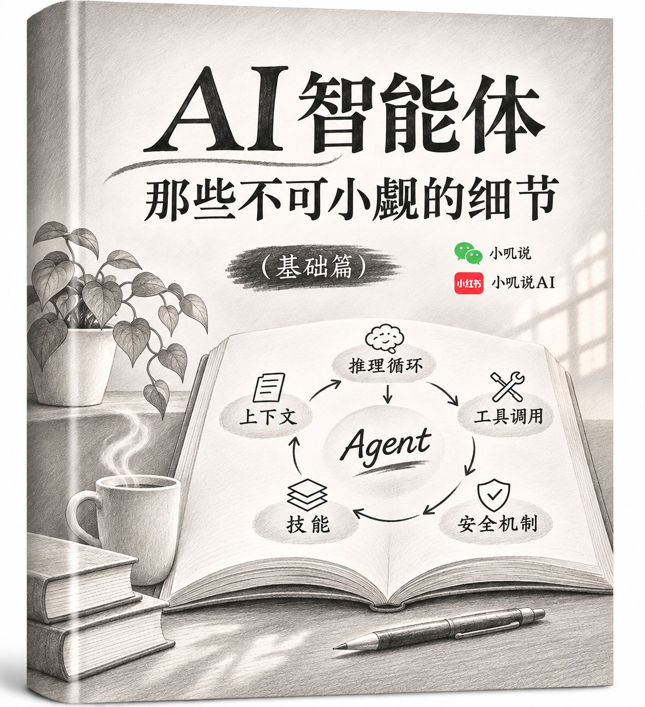

{: width="280" }

# AI智能体那些不可小觑的细节（基础篇）

---

## 目录
1. [版权声明](copyright.md)
2. [自序 瓶颈只会向上迁移](chapters/00-preface.html)
3. [第一章 从计算机到智能体](chapters/01-chapter1.html)
4. [第二章 上下文](chapters/02-chapter2.html)
5. [第三章 内部工具调用](chapters/03-chapter3.html)
6. [第四章 推理循环](chapters/04-chapter4.html)
7. [第五章 安全机制](chapters/05-chapter5.html)
8. [第六章 Skill按需加载的知识](chapters/06-chapter6.html)

---

